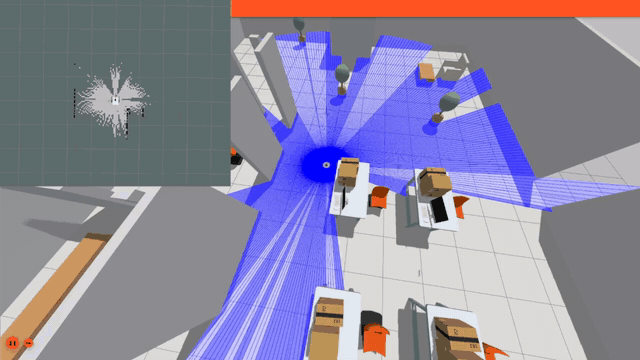
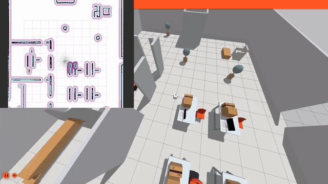

<div align="center">

# Atlas Sim

### Học ROS 2 & Navigation2 trên robot mô phỏng thật:<br>từ node đầu tiên tới robot tự vẽ bản đồ và tự đi tới đích

[](https://docs.ros.org/en/humble/)
[](https://gazebosim.org/docs/fortress)
[](https://docs.nav2.org/)
[](https://releases.ubuntu.com/jammy/)
[](https://atlasroboticsvn.com/vi/khoa-hoc/ros2-nav2)

<a href="https://atlasroboticsvn.com/vi/khoa-hoc/ros2-nav2/module-0/00-cai-dat"><b>▶&nbsp; Học thử miễn phí</b></a> &nbsp;&nbsp;·&nbsp;&nbsp;
<a href="https://atlasroboticsvn.com/vi/khoa-hoc/ros2-nav2"><b>Xem đề cương khóa học</b></a> &nbsp;&nbsp;·&nbsp;&nbsp;
<a href="https://atlasroboticsvn.com/vi/hoi-vien"><b>Mở khóa trọn đời</b></a>

</div>

<br>

<table>
<tr>
<td width="50%" valign="top">

<br><b>Dựng bản đồ bằng SLAM</b> · Module 8
<br><sub>Robot quét LiDAR trong Gazebo, slam_toolbox ghép thành bản đồ</sub>
</td>
<td width="50%" valign="top">

<br><b>Tự điều hướng bằng Nav2</b> · Module 9–12
<br><sub>Trên bản đồ vừa dựng, Nav2 lập đường đi và né vật cản tới đích</sub>
</td>
</tr>
</table>

<p align="center"><sub>Quay thật từ Gazebo + RViz, tua nhanh 1.5×. Xem bản đầy đủ trên <a href="https://atlasroboticsvn.com/vi/khoa-hoc/ros2-nav2">trang khóa học</a>.</sub></p>

## Học xong, robot Atlas của bạn làm được gì

Một robot diff-drive mang LiDAR và IMU, chạy trong Gazebo. Qua từng module, bạn tự dựng nó lên đến khi
nó tự đi làm nhiệm vụ:

| Kỹ năng | Bạn tự làm được |
|---|---|
| **Dựng robot** | URDF/XACRO, đưa vào Gazebo, `ros2_control` cho bánh xe chạy theo `/cmd_vel` |
| **Đọc cảm biến** | LiDAR và IMU: ý nghĩa từng trường dữ liệu, xem trực tiếp trong RViz |
| **Lái an toàn** | Bàn phím, joystick, trộn nhiều nguồn lệnh qua `twist_mux`, lớp an toàn `collision_monitor` |
| **Vẽ bản đồ** | `slam_toolbox`: scan matching, pose graph, loop closure |
| **Định vị** | AMCL (particle filter) trên bản đồ có sẵn, so với `slam_toolbox` localization |
| **Tự điều hướng** | Nav2: costmap, global planner, local controller; so 3 controller DWB, RPP, MPPI |
| **Behavior Tree** | Đọc cây BT thật đang chạy, xem tick lan truyền, 4 recovery behavior |
| **Đồ án "Atlas Delivery"** | Ghép SLAM, AMCL, Nav2, BT và `patrol_node.py` tự viết, có log thời gian, quãng đường, số lần recovery |

## Vì sao học ở đây

- **Thấy dữ liệu chuyển động.** Mỗi bài có mô hình chạy ngay trên trang: message bay qua các tầng, node
  tìm nhau, hàng đợi đầy dần. Bấm tạm dừng, chậm lại 0.5× khi cần.
- **Code thật, không phải ví dụ rút gọn.** Mọi file cấu hình phân tích trong khóa là file đang chạy trong
  chính repo này.
- **Lỗi thật, cách sửa thật.** Khóa giữ lại những lỗi đã gặp khi làm dự án: `vx_max`/`wz_max` vượt giới hạn
  phần cứng, bản đồ SLAM "nhảy" vì world đối xứng, `twist_mux` âm thầm kẹp priority về 255… và cách tìm ra
  từng lỗi.
- **Tiếng Việt**, thuật ngữ kỹ thuật giữ nguyên tiếng Anh.

## Lộ trình: 14 module · 92 bài · khoảng 21 giờ

| Module | Nội dung | Bài | Mở cho |
|:---:|---|:---:|:---:|
| 0 | Cài đặt môi trường | 1 | 🆓 |
| 1 | ROS 2 Core Concepts: node, topic, service, parameter, launch | 9 | 🆓 |
| 2 | TF2 & tọa độ: frame, cây TF, REP-103/105 | 6 | 🆓 |
| 3 | URDF/XACRO | 8 | 🔑 |
| 4 | Đưa robot vào Gazebo | 8 | 🔑 |
| 5 | ros2_control | 8 | 🔑 |
| 6 | Cảm biến: LiDAR & IMU | 8 | 🔑 |
| 7 | Teleoperation & RViz | 8 | 🔑 |
| 8 | SLAM | 8 | ⭐ |
| 9 | Localization với AMCL | 7 | ⭐ |
| 10 | **Nav2 core** (module trọng tâm) | 8 | ⭐ |
| 11 | Recovery & Behavior Tree | 6 | ⭐ |
| 12 | Waypoint & Nav2 Simple Commander | 4 | ⭐ |
| 13 | Đồ án cuối khóa (Capstone) | 3 | ⭐ |

🆓 đọc ngay, không cần tài khoản &nbsp;·&nbsp; 🔑 đăng nhập miễn phí &nbsp;·&nbsp; ⭐ hội viên

## Chạy thử ngay

Cần Ubuntu 22.04 đã cài ROS 2 Humble. Hướng dẫn cài từng bước có trong [Module 0 (miễn phí)](https://atlasroboticsvn.com/vi/khoa-hoc/ros2-nav2/module-0/00-cai-dat).

```bash
sudo apt-get install -y ros-humble-ros-gz ros-humble-gz-ros2-control \
  ros-humble-slam-toolbox ros-humble-navigation2 ros-humble-nav2-bringup \
  ros-humble-teleop-twist-keyboard ros-humble-joy ros-humble-teleop-twist-joy \
  ros-humble-twist-mux
git clone https://github.com/atlasroboticsvn/atlas_sim.git ~/atlas_sim
cd ~/atlas_sim && source /opt/ros/humble/setup.bash && colcon build && source install/setup.bash

# Terminal 1: mô phỏng
ros2 launch atlas_bringup bringup.launch.py world:=maze.sdf
# Terminal 2: lái bằng bàn phím
ros2 run teleop_twist_keyboard teleop_twist_keyboard
```

## Các package (theo thứ tự phụ thuộc)

| Package | Vai trò | Module |
|---|---|---|
| `atlas_description` | URDF/XACRO, RViz xem robot (không cần Gazebo) | 3 |
| `atlas_gazebo` | Spawn robot vào Gazebo Fortress, world (`empty.sdf`, `maze.sdf`), sensor LiDAR+IMU | 4, 6 |
| `atlas_control` | `ros2_control` + `diff_drive_controller`, robot chạy được bằng `/cmd_vel` | 5 |
| `atlas_slam` | `slam_toolbox` tự vẽ bản đồ, lưu map; Nav2 (định vị AMCL hoặc slam_toolbox, costmap/planner/controller, 3 file config DWB/RPP/MPPI) | 8-10 |
| `atlas_bringup` | Điểm khởi chạy chung: `bringup.launch.py` (mô phỏng), joystick teleop qua `twist_mux` | 7 (mở rộng) |

Chỉ `atlas_control` tự include `atlas_gazebo` (spawn + control là 1 tầng "bringup" liền mạch); `atlas_bringup/bringup.launch.py` chỉ include lại `atlas_control/controller.launch.py`, không viết lại logic. Từ `atlas_slam`/`atlas_bringup` (các launch còn lại) trở lên, mỗi package là ứng dụng ĐỘC LẬP với bringup — luôn cần chạy `atlas_bringup bringup.launch.py` riêng ở terminal khác trước, rồi mới chạy package bạn cần (xem ví dụ lệnh bên dưới, luôn có "Terminal 1: bringup"). Chạy thẳng `atlas_control controller.launch.py` vẫn được (dùng khi chỉ làm việc trong phạm vi package đó, vd Module 5). Lái tay dùng thẳng `teleop_twist_keyboard` (gói chuẩn ROS 2) + tự mở RViz — không có package `atlas_teleop` riêng (đã bỏ, chỉ là 1 file `.rviz` cấu hình sẵn, không đáng 1 package).

<details>
<summary><b>Stack và build</b></summary>

- Ubuntu 22.04 + **ROS 2 Humble**
- **Gazebo Fortress** (gz-sim, cài qua `ros-humble-ros-gz` — KHÔNG phải Gazebo Classic)
- `ros2_control` + `ros-humble-gz-ros2-control` (không phải `gazebo-ros2-control`, đó là bản Classic)
- `slam_toolbox`, `nav2_map_server`
- `joy`, `teleop_twist_joy`, `twist_mux` (điều khiển bằng joystick)

Nếu máy mới, cài:
```bash
sudo apt-get update
sudo apt-get install -y ros-humble-ros-gz ros-humble-gz-ros2-control \
  ros-humble-slam-toolbox ros-humble-navigation2 ros-humble-nav2-bringup \
  ros-humble-teleop-twist-keyboard ros-humble-joy ros-humble-teleop-twist-joy \
  ros-humble-twist-mux
```

### Build

```bash
cd ~/atlas_sim
source /opt/ros/humble/setup.bash
colcon build
source install/setup.bash
```
Phải `source install/setup.bash` lại mỗi khi mở terminal mới (hoặc thêm vào `~/.bashrc`).

</details>

<details>
<summary><b>Lệnh chạy đầy đủ: RViz, Gazebo, SLAM, joystick, Nav2</b></summary>

**Chỉ xem robot trong RViz (không Gazebo):**
```bash
ros2 launch atlas_description display.launch.py
```

**Spawn robot vào Gazebo, chưa di chuyển được (test vật lý):**
```bash
ros2 launch atlas_gazebo spawn_robot.launch.py world:=maze.sdf
```

**Mô phỏng đầy đủ, robot di chuyển bằng `/cmd_vel` (dùng cái này là chính):**
```bash
ros2 launch atlas_control controller.launch.py world:=maze.sdf
```
Test nhanh không cần bàn phím:
```bash
ros2 topic pub -r 10 /cmd_vel geometry_msgs/msg/Twist "{linear: {x: 0.2}, angular: {z: 0.0}}"
```

**Lái bằng bàn phím + xem trực quan** (2 terminal riêng, cùng thư mục, đã `source install/setup.bash`):
```bash
# Terminal 1
ros2 launch atlas_bringup bringup.launch.py world:=maze.sdf
# Terminal 2
ros2 run teleop_twist_keyboard teleop_twist_keyboard
```
Muốn xem robot/scan/odom trực quan trong lúc lái, tự mở `rviz2`, thêm display `RobotModel` + `TF` + `LaserScan (/scan)` + `Odometry (/odom)`, fixed frame `odom`.

**Vẽ bản đồ (SLAM)** — `atlas_slam` KHÔNG tự spawn robot/world, chỉ chạy `slam_toolbox` (giống thực tế: SLAM là ứng dụng chạy trên bringup đã có sẵn, không quan tâm robot thật hay mô phỏng):
```bash
# Terminal 1: bringup mô phỏng
ros2 launch atlas_bringup bringup.launch.py world:=maze.sdf
# Terminal 2: SLAM + rviz xem map trực tiếp
ros2 launch atlas_slam slam.launch.py
# Terminal 3: lái đi khắp world (xem mục teleop ở trên)
ros2 run teleop_twist_keyboard teleop_twist_keyboard
```
Sau khi đi hết world, lưu bản đồ:
```bash
ros2 run nav2_map_server map_saver_cli -f src/atlas_slam/maps/maze_map
```

**Lái bằng joystick/gamepad qua `twist_mux`** (thay cho teleop bàn phím — KHÔNG chạy đồng thời cả 2, cả hai đều publish `/cmd_vel`):
```bash
# Terminal 1: bringup mô phỏng
ros2 launch atlas_bringup bringup.launch.py world:=maze.sdf
# Terminal 2: joystick teleop
ros2 launch atlas_bringup joystick_teleop.launch.py
```
Kiểm tra gamepad được máy nhận trước: `ros2 run joy joy_enumerate_devices`.

**Điều hướng tự động (Nav2)** — trên bản đồ đã lưu, có 3 file config controller riêng biệt để chọn (không phải API lúc runtime), và 2 kiểu định vị (AMCL hoặc slam_toolbox):
```bash
# Terminal 1: bringup mô phỏng
ros2 launch atlas_bringup bringup.launch.py world:=maze.sdf
# Terminal 2: Nav2 (mặc định controller=mppi + localization=amcl)
ros2 launch atlas_slam navigation.launch.py
# đổi controller: controller:=dwb | rpp | mppi
# đổi kiểu định vị: localization:=amcl | slam_toolbox (cần đã serialize map, xem maps/README.md)
# slam_toolbox BẮT BUỘC truyền pose ban đầu NGAY LÚC LAUNCH (khác AMCL), xem mục lỗi bên dưới:
ros2 launch atlas_slam navigation.launch.py localization:=slam_toolbox \
  map:=/path/to/map1.yaml initial_pose_x:=0.0 initial_pose_y:=0.0 initial_pose_yaw:=0.0
```
AMCL: sau khi RViz mở, đặt **2D Pose Estimate** đúng vị trí thật của robot trước khi gửi goal. Gửi goal + đo thời gian:
```bash
ros2 run atlas_slam send_goal_and_time.py --goal_x -1.5 --goal_y 1.8
```
So sánh 3 controller: chạy lại `navigation.launch.py` với `controller:=` khác nhau, gửi cùng 1 goal, so thời gian + quan sát độ mượt quỹ đạo trong RViz.

</details>

<details>
<summary><b>Mẹo và lỗi hay gặp (đã tự vấp khi làm dự án)</b></summary>

- **`gz sim` không chạy được** → dùng `ign gazebo` thay thế. Bản Fortress (gz-sim 6) chưa có cú pháp CLI `gz sim`, đó là quy ước từ Garden/Harmonic trở đi. Mở Gazebo trắng để xem giao diện: `ign gazebo`.
- **Bấm phím trong `teleop_twist_keyboard` mà robot không nhúc nhích** → phải chạy bằng `ros2 run` ở terminal riêng, không phải qua `ros2 launch` (launch không đảm bảo forward bàn phím vào tiến trình con).
- **Không thấy tia LiDAR trong Gazebo dù sensor có `visualize: true`** → phải tự bấm chọn robot (hoặc `lidar_link`) trong panel Entity Tree bên trái cửa sổ Gazebo, panel "Visualize Lidar" mới bind vào và vẽ tia.
- **Robot "bốc đít"/lật khi spawn** → đã sửa ở `atlas_description` (thêm caster trước+sau, xem lịch sử sửa lỗi trong hội thoại hoặc git log). Nếu build lại từ nguồn cũ mà gặp lại, kiểm tra `wheel_separation`/caster trong `atlas.urdf.xacro`.
- **Gazebo còn treo tiến trình cũ, launch mới báo "Controller already loaded"** → tiến trình `ign gazebo server`/`gui` cũ chưa bị `ros2 launch` dọn hết khi Ctrl+C. Kiểm tra và tắt tay:
  ```bash
  ps aux | grep -iE "ign gazebo|ros_gz|robot_state_publisher|controller_manager"
  kill -9 <pid...>
  ```
- **`diff_drive_controller` không nhận lệnh dù mọi thứ đúng** → đã cấu hình sẵn `use_stamped_vel: false` trong `atlas_control/config/diff_drive_controller.yaml` (mặc định Humble là `true`, chờ `TwistStamped` thay vì `Twist` thường). Đừng đổi lại trừ khi biết mình đang làm gì.
- **`twist_mux` priority > 255 không có tác dụng như số ghi trong config** → `twist_mux` tự kẹp priority về khoảng [0, 255]. Trong `atlas_bringup/config/joystick_teleop.yaml`, `collision_detect: priority: 1000` thực chất chạy ở mức 255 (đã kiểm chứng qua log lúc launch) — thứ tự ưu tiên tương đối vẫn đúng nên không ảnh hưởng, chỉ đừng định thêm input nào "cao hơn 1000" mà tưởng nó thắng.
- **`localization:=slam_toolbox map:=...` không load map, tự quét map mới** → slam_toolbox (khác AMCL) đòi hỏi biết pose ban đầu NGAY LÚC LAUNCH (`map_start_pose`), thiếu nó sẽ báo lỗi `Map starting pose not specified` rồi coi như quét map mới toanh — dễ nhầm tưởng map không load được. Phải truyền `initial_pose_x/y/yaw:=` khớp vị trí robot lúc launch. Ngoài ra `map:=` giờ dùng CHUNG cho cả 2 kiểu định vị (trước đó có bug: `map:=` chỉ ảnh hưởng AMCL, slam_toolbox âm thầm dùng map mặc định khác — đã sửa).
- **Truyền list qua `RewrittenYaml` bị ghi thành string, không phải array** → `param_rewrites` với `convert_types=True` chỉ tự chuyển kiểu scalar (bool/int/float), không parse được cú pháp list `"[x, y, z]"` — ghi thẳng chuỗi đó vào YAML sẽ làm node đọc sai kiểu tham số và crash (SIGABRT). Muốn truyền tham số kiểu mảng với giá trị lấy từ launch argument, phải dùng `OpaqueFunction` để `.perform(context)` từng phần tử rồi tự ghép thành list Python thật (xem `_make_slam_toolbox_node` trong `navigation.launch.py`) — không có cách nào làm việc này thuần qua `RewrittenYaml`.
- **Bản đồ SLAM thỉnh thoảng "nhảy" 1 phát rồi lệch/lỗi luôn** → world `maze.sdf` cũ có đối xứng tâm 180° hoàn hảo (2 vách trong là ảnh gương của nhau), khiến `slam_toolbox` thỉnh thoảng nhầm 2 vị trí đối xứng là cùng 1 chỗ (loop closure sai). Thử fix nhẹ (thêm 1 cột mốc phá đối xứng) không đủ dứt khoát, lỗi vẫn còn — đã **thiết kế lại toàn bộ world** thành mê cung hình chữ Z, 3 vách dài khác nhau (3.0/2.5/4.1m), phòng ngoài không vuông (7x5m), không còn phép quay/lật nào biến layout thành chính nó. Kèm siết ngưỡng `loop_match_minimum_response_coarse/fine` (0.35/0.45 → 0.45/0.55) trong `atlas_slam/config/mapper_params.yaml` làm lớp phòng vệ thứ 2. Nếu tự vẽ world khác, tránh thiết kế đối xứng/ít đặc trưng — đây là nguyên nhân phổ biến gây lỗi SLAM.

</details>

---

<div align="center">

**[Atlasbot](https://atlasroboticsvn.com)** · khóa học robotics bằng tiếng Việt

Thấy repo hữu ích? Cho một ⭐ để nhiều người biết đến hơn.

</div>
